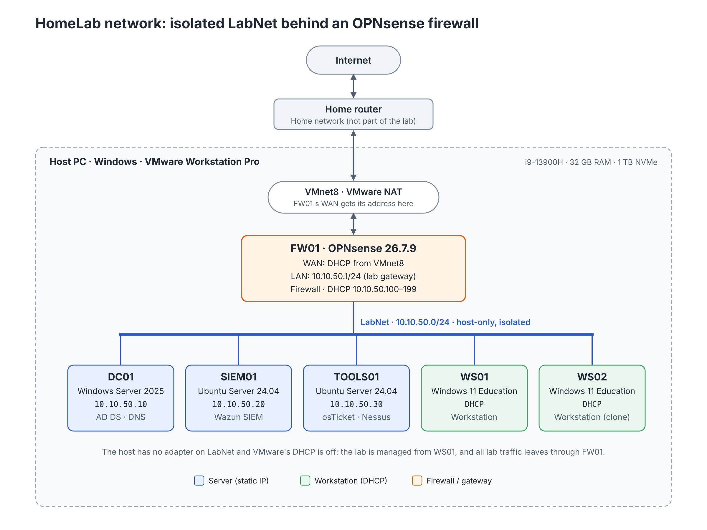

# 00 · Lab Foundation

An isolated, enterprise-style virtual lab network built on VMware Workstation Pro. It's the base for every other project in this repo: an Active Directory help desk lab, a Wazuh SOC detection lab, and an MSP-style patching and backup lab.



## Goals

- Build a private lab network that can't reach my home devices, so I can safely test, break and rebuild things
- Run a real firewall (OPNsense) as the lab's router, DHCP server and gateway
- Stand up the base servers and workstations used by later projects
- Document everything well enough to rebuild the lab from scratch if a VM breaks

## Hardware and software

| Item | Details |
| --- | --- |
| Host CPU | Intel Core i9-13900H (14 cores / 20 threads), hardware virtualization enabled |
| Host RAM | 32 GB |
| Host storage | 1 TB NVMe SSD (VM disks stored on the system drive) |
| Hypervisor | VMware Workstation Pro 17 |
| Firewall | OPNsense 26.7.9_3 |
| Servers | Windows Server 2025 Standard (licensed), Ubuntu Server 24.04 LTS |
| Workstations | Windows 11 Education (school license) |

## Network design

```
Internet
   │
Home network
   │
VMware NAT (VMnet8)
   │  WAN (DHCP from VMware)
┌──┴───────────┐
│ FW01         │  OPNsense: routing, DHCP, firewall
│ 10.10.50.1   │
└──┬───────────┘
   │  LAN
LabNet: 10.10.50.0/24 (host-only, isolated)
   ├── DC01      10.10.50.10   static
   ├── SIEM01    10.10.50.20   static
   ├── TOOLS01   10.10.50.30   static
   ├── WS01      DHCP (10.10.50.100–199)
   └── WS02      DHCP (10.10.50.100–199)
```

**Design decisions**

- **LabNet is a host-only VMware network with the host adapter disconnected.** My physical PC has no address on it, so nothing in the lab can reach my real machines directly. I manage the lab from a browser on WS01.
- **VMware's own DHCP is turned off on LabNet.** OPNsense is the only DHCP server, like a real office network.
- **All lab traffic leaves through FW01.** Every packet in or out of the lab passes through a firewall I control and can log.
- **Servers get static IPs; workstations use DHCP.** Clients can always find infrastructure at a known address, and workstation addressing stays automatic.
- **Lab networks are kept separate from my coursework.** LabNet uses its own VMnet and subnet so class VMs and lab VMs never share a network.

## Virtual machines

| VM | OS | vCPU | RAM | Disk | IP | Role |
| --- | --- | --- | --- | --- | --- | --- |
| FW01 | OPNsense | 2 | 2 GB | 20 GB | 10.10.50.1 | Firewall, router, DHCP |
| DC01 | Windows Server 2025 | 2 | 4 GB | 60 GB | 10.10.50.10 | Domain controller and DNS (Project 01) |
| SIEM01 | Ubuntu Server 24.04 | 4 | 8 GB | 80 GB | 10.10.50.20 | Wazuh SIEM (Project 02) |
| TOOLS01 | Ubuntu Server 24.04 | 2 | 4 GB | 40 GB | 10.10.50.30 | osTicket, Nessus |
| WS01 | Windows 11 Education | 2 | 4 GB | 64 GB | DHCP | Domain workstation |
| WS02 | Windows 11 Education (full clone of WS01) | 2 | 4 GB | 64 GB | DHCP | Domain workstation / patch pilot |

I don't run every VM at once. I start only what the current project needs and leave about 8 GB of RAM for the host.

## Build summary

1. Confirmed hardware virtualization was enabled, and kept Hyper-V and Windows Hypervisor Platform off so Workstation runs at full speed.
2. Created **LabNet** in the Virtual Network Editor: host-only, `10.10.50.0/24`, no host virtual adapter, no VMware DHCP.
3. Built **FW01** with two NICs: WAN on VMware NAT and LAN on LabNet. Installed OPNsense, set LAN to `10.10.50.1/24`, and enabled DHCP for `.100–.199`.
4. Built **DC01** (Windows Server 2025 Desktop Experience) and set its static IP with PowerShell:
   ```powershell
   New-NetIPAddress -InterfaceAlias "Ethernet0" -IPAddress 10.10.50.10 -PrefixLength 24 -DefaultGateway 10.10.50.1
   Set-DnsClientServerAddress -InterfaceAlias "Ethernet0" -ServerAddresses 10.10.50.1
   ```
5. Built **WS01** (Windows 11 Education, virtual TPM) on DHCP, then made **WS02** as a full clone of WS01. After cloning, I confirmed WS02 had its own MAC address and renamed the Windows computer itself, not just the VMware VM: renaming the VM doesn't change the hostname, and a duplicate hostname would collide in DNS and Active Directory. I also ran `sysprep /generalize /oobe` on WS02 before it joined the domain, so it has its own machine identity rather than a copy of WS01's. Sysprep keeps existing local accounts, so afterward I removed the extra account created during setup and kept `Win01` as the local admin on both workstations. Windows LAPS needs that account name to match on every machine it manages.
6. Built **TOOLS01/SIEM01** (Ubuntu Server with static IPs set in the installer).
7. Took a `00-clean-install` snapshot of every VM.

## Verification

| Test | Expected | Result |
| --- | --- | --- |
| WS01 → `ping 10.10.50.1` (firewall) | Reply | ✅ Pass |
| WS01 → `ping 10.10.50.10` (DC01) | Reply | ✅ Pass |
| WS01 → `ping 1.1.1.1` (internet via FW01) | Reply | ✅ Pass |
| TOOLS01 → `ping 10.10.50.10` | Reply | ✅ Pass |
| Host PC → `ping 10.10.50.10` | **Fail** (proves isolation) | ✅ Pass |
| `ipconfig` on host shows no 10.10.50.x adapter | No adapter | ✅ Pass |

## Troubleshooting log

### 1. WS01 fell back to a 169.254.x.x address

**Symptom:** After configuring networking on WS01, `ipconfig` showed an *Autoconfiguration IPv4 Address* of `169.254.228.221` with a `255.255.0.0` mask, yet the default gateway still read `10.10.50.1`. Re-running `New-NetIPAddress` failed with *"Instance MSFT_NetIPAddress already exists."*

**Investigation:**
```powershell
Get-NetIPAddress -InterfaceAlias "Ethernet0" -AddressFamily IPv4 |
  Format-Table IPAddress, PrefixLength, AddressState, PrefixOrigin
```
`10.10.50.10` showed **AddressState: Duplicate**. I had accidentally run DC01's static-IP command on WS01. Windows detected that DC01 already owned `.10`, refused to use it, and fell back to an APIPA address.

**Fix:** Reverted WS01 to its last VMware snapshot, taken before the network change. That undid the bad static IP, gateway and DNS settings in one step, and WS01 came back up on DHCP with an address from FW01.

**Lesson:** A 169.254 address means Windows couldn't get or use a valid IPv4 address; check `AddressState` before re-running configuration commands. Snapshots before every change turned a messy cleanup into a one-click rollback. Keep a written IP plan and confirm which machine you're on before applying static settings.

### 2. WS01 could ping the gateway but not DC01

**Symptom:** WS01 got replies from `10.10.50.1` but not from `10.10.50.10`.

**Investigation:** DC01 could ping the gateway itself, so both machines were on the network. Running `arp -a` on WS01 after a failed ping showed DC01's MAC address, which means layer 2 was working and something on DC01 was dropping the ICMP requests.

**Cause:** Windows Server blocks inbound ICMPv4 echo requests by default.

**Fix:** Enabled the built-in rule on DC01:
```powershell
Enable-NetFirewallRule -Name FPS-ICMP4-ERQ-In
```

**Lesson:** A failed ping doesn't mean the host is down. Check whether the host firewall is dropping it. `arp -a` quickly separates network problems from firewall problems.

### 3. Cloned VM wouldn't power on: unknown encryption password

**Symptom:** WS02, a full clone of WS01, asked for an encryption password at power-on. WS01 opened without a prompt, and I didn't know the password.

**Investigation:** VMware Workstation encrypts Windows 11 VMs so it can provide a virtual TPM. A full clone keeps the source VM's encryption password, but Workstation saves remembered passwords per VM, keyed to the `.vmx` path, so the clone had no saved password. `cmdkey /list` on the host showed WS01's saved entry in Windows Credential Manager under the target `VMware Encrypted VM: <path to WS01.vmx>`.

**Fix:** Read the stored secret with the `CredentialManager` PowerShell module. It first printed as unreadable characters because VMware stores the password as single-byte text while the module decodes it as UTF-16. Re-encoding the bytes recovered the password:
```powershell
$p = (Get-StoredCredential -Target "VMware Encrypted VM: <path to WS01.vmx>" -AsCredentialObject).Password
[System.Text.Encoding]::UTF8.GetString([System.Text.Encoding]::Unicode.GetBytes($p)).TrimEnd([char]0)
```
WS02 then unlocked. I saved the password in my password manager and cleared the variable and console.

**Lesson:** Credential stores are only as good as your notes. Encryption passwords go in a password manager when they're created, not just in the hypervisor's cache. A garbled secret is often an encoding mismatch rather than a wrong value.

## Skills demonstrated

- Virtual network design and network isolation
- Firewall and router deployment (OPNsense): interface assignment, DHCP and gateway configuration
- Windows Server and Windows 11 deployment, including virtual TPM and VM cloning
- Static vs. dynamic IP addressing; PowerShell network configuration (`NetTCPIP` cmdlets)
- Layer 2/3 troubleshooting: APIPA, duplicate address detection, ARP, host firewall rules
- Windows Credential Manager and character-encoding troubleshooting
- Snapshot-based change management and documentation

## Next

[01 · Active Directory help desk lab](../01-active-directory/): promote DC01 to a domain controller, build OUs, users and Group Policy, and work help desk tickets in osTicket.

---

*Licensing: Windows Server 2025 and Windows 11 Education run on my own license keys, so there are no evaluation timers. No passwords, license keys or real network details are stored in this repo.*
