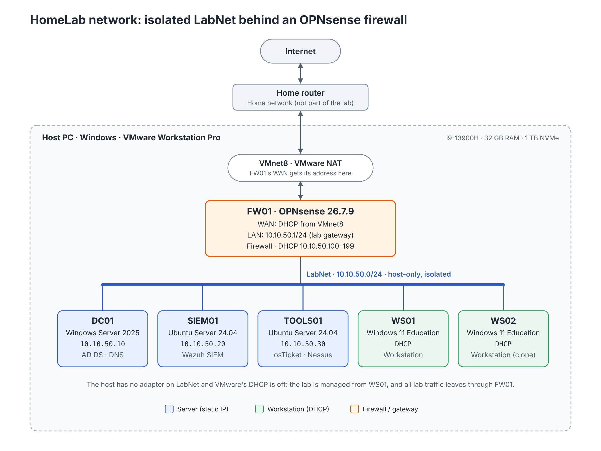

# Home Lab: Enterprise IT and Security Practice Environment

A self-built, isolated lab that simulates a small company network. I use it to practice the day-to-day work of **help desk, SOC analyst and sysadmin/MSP** roles: building infrastructure, supporting users, detecting attacks, patching and backing up systems, and documenting everything along the way.

Each project folder has a full write-up: goals, design decisions, build steps, verification results, and a troubleshooting log of what broke and how I fixed it.

## Projects

| # | Project | What it covers | Status |
| --- | --- | --- | --- |
| 00 | [Lab Foundation](00-foundation/) | Isolated virtual network, OPNsense firewall, Windows Server and Windows 11 builds, network troubleshooting | ✅ Complete |
| 01 | Active Directory Help Desk | AD DS, OUs and groups, Group Policy, Windows LAPS, PowerShell user automation, osTicket ticket workflows | 🔄 Up next |
| 02 | SOC Detection | Wazuh SIEM, Sysmon, Windows audit logging, MITRE ATT&CK-mapped detections, incident reports | ⏳ Planned |
| 03 | MSP Operations | Nessus vulnerability scanning, Action1 patch management, security baselines, Veeam backups and restore testing | ⏳ Planned |
| 04 | Home Network Security | Real-world network hardening, OPNsense with VLAN segmentation, Suricata IDS, DNS filtering, Tailscale remote access | ⏳ Planned |

## Lab at a glance

| Component | Details |
| --- | --- |
| Host | Intel Core i9-13900H, 32 GB RAM, 1 TB NVMe SSD |
| Hypervisor | VMware Workstation Pro |
| Firewall | OPNsense (FW01) |
| Lab network | LabNet, `10.10.50.0/24`: host-only and isolated from my home network |
| Servers | Windows Server 2025 (DC01), Ubuntu Server 24.04 (SIEM01, TOOLS01) |
| Workstations | Windows 11 Education (WS01, WS02) |

## Tools and skills

- **Infrastructure:** VMware Workstation, OPNsense, Windows Server 2025, Active Directory, DNS, DHCP, Group Policy, Ubuntu Server
- **Security:** Wazuh, Sysmon, MITRE ATT&CK, Nessus, Windows LAPS, Microsoft security baselines, Suricata
- **Operations:** PowerShell, Bash, Action1, Veeam, osTicket, Tailscale, Git

## How this lab is run

- **Isolated by design.** The lab network has no connection to my home devices; all traffic goes through the lab firewall.
- **Snapshot before every change.** Each VM gets a snapshot before a project starts, so mistakes are a quick rollback rather than a rebuild.
- **No secrets in this repo.** Passwords, license keys and real network details live in a password manager, never here.

## About me

I'm a cybersecurity student building hands-on experience for help desk, IT support and junior security roles.

[LinkedIn](https://www.linkedin.com/in/corey-quintanilla-ab59a461/)
